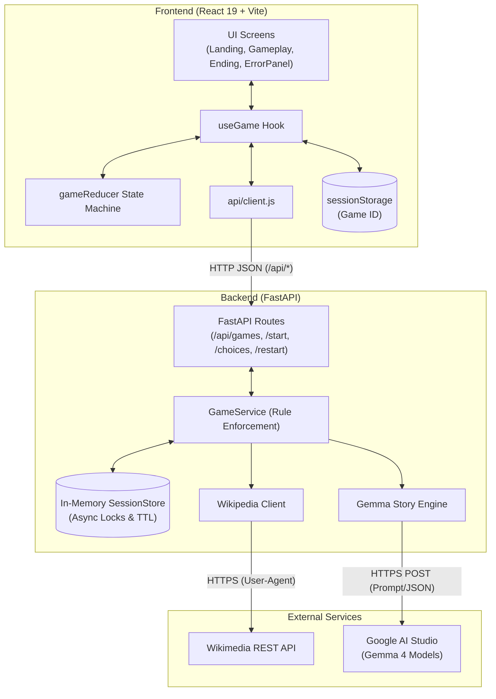
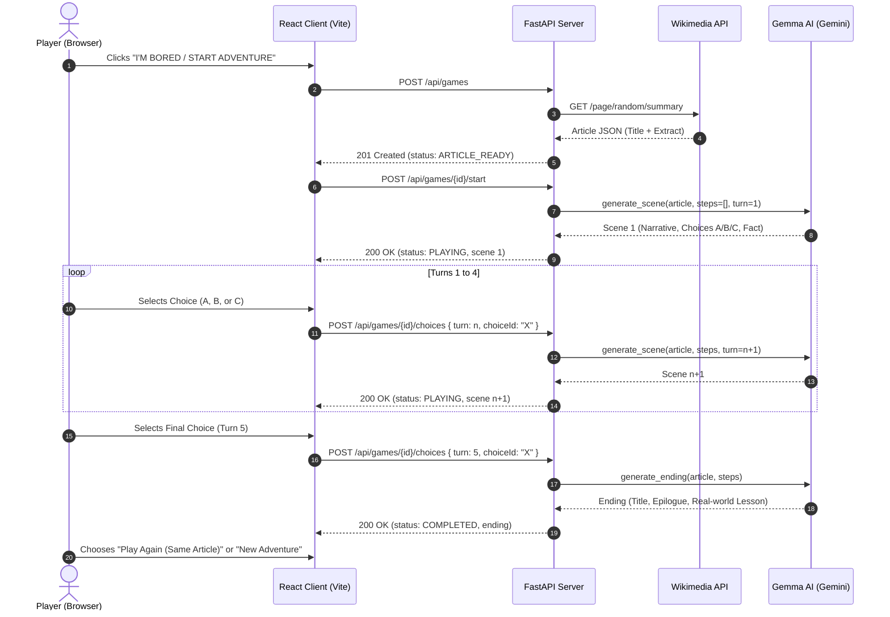

# 🐇 RabbitHole: The AI Adventure Generator

> **Finite Loop OSS Fest — Best Use of Gemma**  
> Transform serendipitous Wikipedia articles into branching, 5-turn interactive text adventures powered by **Google Gemma 4**.

---

## 📖 1. Project Overview

**RabbitHole** is an interactive, narrative-driven adventure generator designed to make exploring human knowledge fun, engaging, and unpredictable.

### The Problem
With millions of articles on Wikipedia, serendipitous learning is often passive: readers skim dense text or get lost in endless hyperlinking without emotional investment or active reflection.

### The Solution
RabbitHole turns Wikipedia into an interactive choose-your-own-adventure game:
1. It queries Wikipedia's REST API for a random, quality-vetted article (filtering out stubs, lists, and disambiguation pages).
2. It feeds the real-world article extract and topic into **Google Gemma 4** (`gemma-4-26b-a4b-it` / `gemma-4-31b-it`) via the Gemini API.
3. Gemma dynamically crafts an episodic, 5-turn branching narrative where every choice impacts subsequent scenes.
4. Each turn embeds verified historical/scientific facts into the story.
5. At turn 5, the player reaches a cohesive, satisfying ending complete with a real-world takeaway lesson.

---

## ✨ 2. Key Features

### ✅ Fully Implemented Features
- **🎲 Curated Wikipedia Discovery**: Fetches random articles using `httpx` with automated filtering (rejects articles under 300 characters, lists, stubs, and disambiguations).
- **🧠 Dynamic Gemma Story Generation**:
  - Turn-aware prompt engineering generating structured JSON scenes (narrative, 3 choices labeled A/B/C, and real-world facts).
  - Turn 5 concludes with an epilogue title, narrative conclusion, and educational takeaway lesson.
  - Built-in resilient fallback/mock generator for local testing without an API key or when offline.
- **🛡️ Concurrency & State Safety**:
  - Enforced 5-turn rules strictly managed on the backend.
  - Per-game `asyncio.Lock` prevents duplicate form submissions or double clicks from burning turns.
  - Stale turn detection (`409 STALE_TURN`) and state reconciliation.
  - In-memory thread-safe session store with TTL expiration (default 2 hours, up to 500 games).
- **🕹️ Robust Client-Side State Machine**:
  - React reducer tracking distinct phases: `IDLE`, `FETCHING_ARTICLE`, `GENERATING`, `PLAYING`, `COMPLETED`, and recoverable `ERROR`.
  - Non-blocking UX: When Gemma is generating turn $N+1$, the current scene remains visible with a loading/busy indicator.
  - `sessionStorage` persistence allows resuming ongoing games seamlessly on page reload.
- **🎨 Accessible, Modern UI**:
  - Semantic HTML5, accessible skip links, keyboard navigation (`1`/`2`/`3` and `A`/`B`/`C`), and screen-reader considerations.
  - Built with Tailwind CSS v4 and responsive layouts.
- **🐳 Single-Container Deployment**: Multi-stage Docker build packaging both the compiled React static files and FastAPI web server.

---

## 🛠️ 3. Tech Stack

| Layer | Technologies & Libraries |
|---|---|
| **Frontend** | React 19 (`react`, `react-dom`), Vite 8, Tailwind CSS v4 (`@tailwindcss/vite`), Vitest 5 |
| **Backend** | Python 3.11+, FastAPI 0.115+, Uvicorn 0.30+, Pydantic 2.7+, HTTPX 0.27+, Python-Dotenv |
| **AI / LLM** | Google Gemma (`gemma-4-26b-a4b-it`, `gemma-4-31b-it`) via Google AI Studio / Gemini API REST |
| **External APIs** | Wikimedia REST API (`/api/rest_v1/page/random/summary`) |
| **Testing** | Vitest (frontend unit & component tests), Pytest & AnyIO (backend asynchronous tests) |
| **DevOps** | Docker (multi-stage `node:22-slim` + `python:3.12-slim`) |

---

## 🏛️ 4. Project Architecture



---

## 📂 5. Folder Structure

```
.
├── Dockerfile                    # Multi-stage container build (web + API)
├── README.md                     # Comprehensive project documentation
├── backend/                      # Backend FastAPI service
│   ├── .env.example              # Template for backend environment variables
│   ├── requirements.txt          # Python runtime dependencies
│   ├── app/
│   │   ├── config.py             # App settings (Pydantic / dotenv)
│   │   ├── errors.py             # Custom AppError with standard error codes
│   │   ├── game_service.py       # Game lifecycle, rules, and turn controller
│   │   ├── main.py               # FastAPI app, error handlers, static file serving
│   │   ├── schemas.py            # Pydantic schemas (Article, Scene, Choice, GameView)
│   │   ├── sessions.py           # In-memory session store with TTL & asyncio locks
│   │   ├── story_engine.py       # Member 4 contract interface
│   │   └── wikipedia.py          # Wikipedia random article fetcher & sanitizer
│   └── tests/
│       ├── conftest.py           # Pytest fixtures and mock environments
│       ├── fakes.py              # Test stubs and mock Wikipedia articles
│       ├── test_api.py           # End-to-end API integration tests
│       └── test_wikipedia.py     # Independent Wikipedia module tests
├── frontend/                     # React 19 Single Page App
│   ├── package.json              # Frontend scripts & dependencies
│   ├── vite.config.js            # Vite configuration with /api proxy to FastAPI
│   ├── index.html                # HTML5 entrypoint with Google Fonts
│   └── src/
│       ├── App.jsx               # Screen router driven by gameReducer state
│       ├── main.jsx              # React DOM mounting
│       ├── index.css             # Tailwind CSS & design tokens
│       ├── api/
│       │   └── client.js         # HTTP client communicating with backend
│       ├── components/           # Presentation components
│       │   ├── Header.jsx        # Top banner with branding
│       │   ├── Landing.jsx       # Starting hero screen ("I'm Bored" button)
│       │   ├── Loading.jsx       # Animated loading screen
│       │   ├── Gameplay.jsx      # Turn scene, choices, and fact card
│       │   ├── Ending.jsx        # Epilogue screen and replay triggers
│       │   ├── ErrorPanel.jsx    # Friendly error messaging with retry
│       │   └── components.test.jsx # Vitest suite for UI components
│       ├── hooks/
│       │   └── useGame.js        # Game controller hook
│       └── state/
│           ├── gameReducer.js    # Pure finite state machine reducer
│           └── gameReducer.test.js # Vitest suite for state transitions
└── gemma_service/                # Dedicated Gemma AI modules & standalone CLI
    ├── client.py                 # Asynchronous Google AI Studio client
    ├── engine.py                 # Story engine with offline dynamic generators
    ├── prompts.py                # Structured JSON prompt engineering
    ├── schemas.py                # Gemma request and response models
    ├── server.py                 # Standalone microservice alternative
    └── cli.py                    # Terminal interactive playable story demo
```

---

## ⚡ 6. Installation & Setup

### Prerequisites
- Python 3.11 or higher
- Node.js 20 or higher (`npm` included)
- Optional: Docker

---

### Step 1: Clone the Repository
```bash
git clone https://github.com/Rakshan07/HACKLOOP-.git
cd HACKLOOP-
```

---

### Step 2: Configure Backend

```bash
cd backend

# Create virtual environment
python -m venv .venv

# Activate virtual environment
# Windows:
.venv\Scripts\activate
# Linux/macOS:
source .venv/bin/activate

# Install dependencies
pip install -r requirements.txt

# Create your .env file
cp .env.example .env
```

Open `backend/.env` and insert your Gemini API Key:
```env
GEMINI_API_KEY=your_actual_gemini_api_key_here
```
*(Note: If left empty, the engine automatically falls back to deterministic mock generators for offline testing).*

Start the FastAPI backend:
```bash
uvicorn app.main:app --reload --port 8000
```
Backend API will be running on `http://localhost:8000` (docs at `http://localhost:8000/docs`).

---

### Step 3: Configure Frontend

Open a new terminal window:
```bash
cd frontend

# Install dependencies
npm install

# Start development server
npm run dev
```

Open your browser at `http://localhost:5173`. The Vite development server automatically proxies all `/api` requests to `http://localhost:8000`.

---

## 🔐 7. Environment Variables

Create a `backend/.env` file matching this template:

```env
# Google AI Studio / Gemini API Key (keep private, never commit!)
GEMINI_API_KEY=your_gemini_api_key_here

# Model identifier
GEMMA_MODEL=gemma-4-26b-a4b-it

# Maximum wait time for Gemma to respond before raising a GEMMA_TIMEOUT (seconds)
GEMMA_TIMEOUT_SECONDS=40

# Token budget for generated scenes and endings
GEMMA_MAX_OUTPUT_TOKENS=1500

# User-Agent header sent to Wikimedia API
WIKI_USER_AGENT=RabbitHole/1.0 (hackathon project; contact: team@example.com)

# Allowed CORS origins (only needed if frontend is hosted on another port/domain)
CORS_ORIGINS=http://localhost:5173

# Game session lifespan and concurrency limits
GAME_TTL_SECONDS=7200
MAX_GAMES=500
```

---

## 🎮 8. How It Works



---

## 📡 9. API Documentation

All API endpoints return JSON with camelCase fields. Standard error responses adhere to `{ "error": { "code": string, "message": string, "retryable": boolean } }`.

### `GET /api/health`
Checks server status and whether an AI key is loaded.
- **Response**: `200 OK`
  ```json
  {
    "status": "ok",
    "model": "gemma-4-26b-a4b-it",
    "aiConfigured": true
  }
  ```

### `POST /api/games`
Discovers a random Wikipedia topic and initializes a game session.
- **Response**: `201 Created`
  ```json
  {
    "gameId": "d3b07384-d113-4966-9c0e-61e86057a627",
    "status": "ARTICLE_READY",
    "turn": 1,
    "totalTurns": 5,
    "article": {
      "title": "Voyager 1",
      "extract": "Voyager 1 is a space probe launched by NASA...",
      "url": "https://en.wikipedia.org/wiki/Voyager_1",
      "thumbnailUrl": "https://upload.wikimedia.org/..."
    },
    "scene": null,
    "ending": null,
    "history": []
  }
  ```

### `POST /api/games/{gameId}/start`
Triggers generation of the opening scene (Turn 1). Idempotent and safe to repeat.
- **Response**: `200 OK` (Status becomes `PLAYING`, includes `scene`).

### `POST /api/games/{gameId}/choices`
Applies player decision.
- **Request Body**:
  ```json
  {
    "turn": 1,
    "choiceId": "B"
  }
  ```
- **Response**: `200 OK`
  - Turns 1–4: Returns next `scene` with status `PLAYING`.
  - Turn 5: Returns story `ending` with status `COMPLETED`.

### `POST /api/games/{gameId}/restart`
Creates a new game session using the exact same Wikipedia article.
- **Response**: `201 Created` (`ARTICLE_READY`).

### `GET /api/games/{gameId}`
Fetches the current state of an active session. Enables restoring progress upon browser refresh.

---

## 🧪 10. Verification & Test Suite

### Frontend Tests (Vitest)
```bash
cd frontend
npm test
```
- **14 passing tests** across `gameReducer.test.js` (state machine transitions, error recovery, replay wiping) and `components.test.jsx` (accessible buttons, skip links, loading stages).

### Backend Tests (Pytest)
```bash
cd backend
python -m pytest tests/ -v
```
- Tests Wikipedia sanitization, rate-limiting, error fallbacks, concurrent game lock safety, and session expiration.

---

## 🐳 11. Docker Deployment

Deploy the combined backend and frontend from a single self-contained image:

```bash
# Build the container
docker build -t rabbit-hole .

# Run the container
docker run -d -p 8000:8000 -e GEMINI_API_KEY="your_api_key_here" rabbit-hole
```

Access the application in your browser at `http://localhost:8000`.

---

## 👥 12. Team Roles & Contributions

Developed collaboratively for **Finite Loop OSS Fest**:

| Member | Primary Ownership | Verified Code Deliverables |
|---|---|---|
| **Member 1** | Frontend UI & Components | Created accessible presentation components (`Header.jsx`, `Landing.jsx`, `Gameplay.jsx`, `Ending.jsx`, `Loading.jsx`, `ErrorPanel.jsx`), design system tokens, and component tests (`components.test.jsx`). |
| **Member 2** | Frontend State Machine & Client | Built `useGame` React hook, `api/client.js`, pure state machine `gameReducer.js`, state machine tests, Dockerfile, and Wikipedia independent test suite. |
| **Member 3** | Backend Architecture & Sessions | Authored FastAPI server (`app/main.py`), in-memory session manager with asyncio locks (`sessions.py`), Wikipedia fetcher/sanitizer (`wikipedia.py`), rules coordinator (`game_service.py`), and test harness. |
| **Member 4** | AI Prompt Engineering & Gemma Integration | Designed Gemma 4 structured prompting (`prompts.py`), Gemini API client (`client.py`), story coordinator with dynamic offline fallback generators (`engine.py`), and CLI demo. |

---

## ⚠️ 13. Known Limitations

- **In-Memory Session Storage**: Active games are stored in backend process memory (`sessions.py`). Restarting or redeploying the backend resets active game sessions (handled cleanly on the frontend via `GAME_NOT_FOUND` reset).
- **Rate Limits on Wikipedia**: Wikipedia REST API is called without authentication; excessive rapid bursts may trigger HTTP 429 / 503 errors (handled by client with retryable error state).
- **Language**: Story generation is currently configured for English Wikipedia articles only.

---

## 🔮 14. Future Improvements

- **Persistent Database**: Implement Redis or SQLite backend to persist saved games across server restarts.
- **Audio Narration**: Integrate Web Audio / Text-to-Speech API to narrate Gemma's stories out loud.
- **Custom Topic Picker**: Allow players to search or enter a specific topic rather than purely random articles.
- **Multiplayer Mode**: Allow friends to vote on choices in a shared lobby before advancing turns.